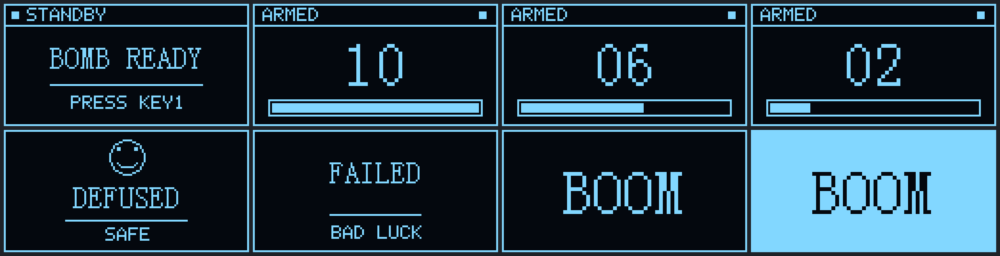
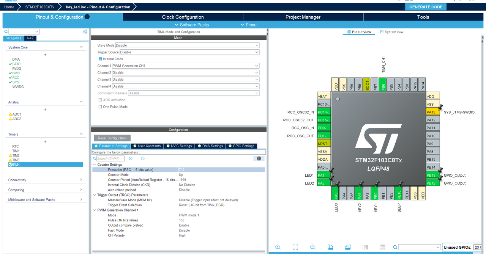

# CS:GO 炸弹模拟器 · STM32 + OLED

> 用一块 STM32F103 和一片 0.96" OLED 复刻 CS:GO 的拆包场景：
> 倒计时越来越急，舵机跟着一起摆，最后那一下全凭运气。



一排八个界面，从左到右：待机 → 倒计时 10 s / 6 s / 2 s → 拆弹成功 → 拆弹失败 → 引爆（黑底 / 反色）。

---

## 功能

- **10 秒真实倒计时**，大号数字显示，底部进度条同步收缩
- **蜂鸣 + LED + 舵机同一节拍**，从每秒 1 拍加速到每秒 5 拍
- **概率拆弹**：按得越早越稳，拖到最后就是赌命
- **三种结局**：拆弹成功 / 按键失败 / 超时引爆，各有独立的画面与音效
- SSD1306 驱动自带**帧缓冲**，整屏一次刷新，没有擦除闪烁
- OLED 上电**自动探测**从机地址（0x78 / 0x7A）与 SCL/SDA 顺序，接反了也能点亮

## 玩法

| 操作 | 说明 |
|---|---|
| 按 **KEY1** | 安包，开始 10 秒倒计时 |
| 按 **KEY2** | 尝试拆弹，**成功与否看概率** |
| 什么都不做 | 10 秒后引爆 |

按住 KEY2 不会连续抽奖——按下判定一次，立即出结果。

### 拆弹成功率

成功率随剩余时间线性下降，所以要自己权衡"早点稳妥"还是"卡最后一秒"：

| 剩余时间 | 10 s | 9 s | 8 s | 7 s | 6 s | 5 s | 4 s | 3 s | 2 s | 1 s |
|---|---|---|---|---|---|---|---|---|---|---|
| 成功率 | 80% | 74% | 68% | 62% | 56% | 50% | 44% | 38% | 32% | 26% |

判定用的是 xorshift32，种子混入毫秒计数器和 SysTick 递减计数器，两次运行不会重复。

失败时屏幕先显示 `FAILED / BAD LUCK` 并叫两声，然后才引爆——让你知道是"按了但赌输了"，而不是"按键没响应"。

## 硬件

| 元件 | 型号 / 规格 | 数量 |
|---|---|---|
| 主控 | STM32F103C8T6 最小系统板（常见蓝色板 / 野火等） | 1 |
| 显示 | SSD1306 OLED 0.96"，**四针 I2C**（GND/VCC/SCL/SDA） | 1 |
| 舵机 | SG90 / MG90S 等 50 Hz 标准舵机 | 1 |
| 蜂鸣器 | **有源**蜂鸣器（给电就响，不需要 PWM 驱动） | 1 |
| LED | 3 mm / 5 mm 任意颜色 | 3 |
| 按键 | 轻触按键 | 2 |
| 电阻 | LED 限流 220 Ω ~ 1 kΩ | 3 |

## 接线

| 功能 | STM32 引脚 | 接到 | 电平约定 |
|---|---|---|---|
| OLED SCL | **PB13** | OLED SCL | 推挽输出（软件 I2C） |
| OLED SDA | **PB12** | OLED SDA | 推挽输出 / 读 ACK 时切输入 |
| OLED 电源 | 3.3 V / GND | OLED VCC / GND | **必须共地** |
| 舵机信号 | **PB6** | 舵机橙线（信号） | TIM4_CH1，50 Hz PWM |
| 舵机电源 | 5 V / GND | 舵机红 / 棕 | 大舵机建议独立供电 |
| 蜂鸣器 | **PB10** | 蜂鸣器负极 | **低电平响**：正极接 3.3 V，负极接 PB10 |
| LED1 / 2 / 3 | **PA1 / PA2 / PA3** | LED 阴极 | **低电平亮**：3.3 V → 电阻 → LED 阳极 → PBx |
| KEY1（安包） | **PB0** | 按键一端，另一端接 **3.3 V** | 内部下拉，**高电平有效** |
| KEY2（拆弹） | **PA6** | 按键一端，另一端接 **3.3 V** | 内部下拉，**高电平有效** |

> ⚠️ **按键是高电平有效**。如果你用的是开发板自带的按键（通常一端接 GND、靠内部上拉，按下为低），需要把 `MX_GPIO_Init()` 里的 `GPIO_PULLDOWN` 改成 `GPIO_PULLUP`，并把代码里的 `== GPIO_PIN_SET` 改成 `== GPIO_PIN_RESET`。

> 蜂鸣器如果是无源的（给直流只会"嗒"一声），需要换成有源的，或者改用 PWM 驱动；电流超过 20 mA 时建议串一个 NPN 三极管。

## CubeMX 配置

工程由 STM32CubeMX 生成，`.ioc` 在仓库根目录。

### 时钟树

```
HSE 8 MHz  →  PLL ×9  →  SYSCLK 72 MHz
                          ├─ AHB  /1  →  HCLK 72 MHz
                          ├─ APB1 /2  →  36 MHz（TIM4 时钟因此为 72 MHz）
                          └─ APB2 /1  →  72 MHz
FLASH latency = 2
```

| 项目 | 设置 |
|---|---|
| RCC | HSE = Crystal/Ceramic Resonator |
| SYS → Debug | **Serial Wire**（只占 PA13/PA14） |
| SYS → Timebase | SysTick |

### 引脚

| 引脚 | 模式 | 标签 | 说明 |
|---|---|---|---|
| PA1 / PA2 / PA3 | GPIO_Output (Push Pull, No pull) | LED1 / LED2 / LED3 | 初始电平 **High**（灯灭） |
| PA6 | GPIO_Input (Pull-down) | KEY2 | 拆弹键 |
| PB0 | GPIO_Input (Pull-down) | KEY1 | 安包键 |
| PB6 | TIM4_CH1 | — | 舵机 PWM |
| PB10 | GPIO_Output (Push Pull) | BEEP | 初始电平 High（不响） |
| PB12 / PB13 | GPIO_Output (Push Pull) | — | OLED SDA / SCL |
| PA13 / PA14 | SYS_JTMS-SWDIO / SYS_JTCK-SWCLK | — | 调试口，**不要改成普通 GPIO** |

> PB12 / PB13 在 CubeMX 里配成输出只是为了"上电有个确定电平"。驱动 `OLED_Init()` 会重新配置这两只脚（读 ACK 时需要临时切输入），所以 CubeMX 这里的设置不是最终状态。

### TIM4（舵机 PWM）



| 参数 | 值 | 结果 |
|---|---|---|
| Prescaler (PSC) | 719 | 72 MHz / 720 = **100 kHz** 计数频率 |
| Counter Period (ARR) | 1999 | 2000 counts = **20 ms = 50 Hz** |
| PWM Mode | PWM1 | |
| Pulse (CCR) | 150 | 上电 1.5 ms ≈ 舵机中位 |
| Channel | CH1 | 输出到 PB6 |

CCR 与舵机角度的关系：**1 count = 10 µs**，`CCR=50` → 0.5 ms → 0°，`CCR=250` → 2.5 ms → 180°。

### 生成选项

- Toolchain / IDE：**MDK-ARM V5**

## 编译与烧录

1. Keil MDK 打开 `MDK-ARM/key_led.uvprojx`
2. 确认 `Options for Target → Debug` 选的是 **ST-Link Debugger**，Port 选 **SW**
3. Build → Download

命令行构建：

```bat
"C:\Keil_v5\UV4\UV4.exe" -r "MDK-ARM\key_led.uvprojx" -j0 -o "build.log"
```

资源占用（AC5，-O3）：

```
Code=8212  RO-data=2376  RW-data=36  ZI-data=2732
```

RAM 里那 2 KB 是 OLED 帧缓冲（1024 B）+ 字模指针等，F103C8 的 20 KB 完全够用。

## 代码结构

```
key_led/
├── Core/
│   ├── Inc/                # CubeMX 生成的头文件（main.h 等）
│   ├── Src/                # main.c：游戏流程、界面布局、概率逻辑
│   └── OLED/               # 自己加的 SSD1306 驱动
│       ├── oled.c          # 软件 I2C + 帧缓冲 + 绘图原语
│       ├── oled.h
│       └── oledfont.h      # 6x8 / 8x16 点阵字模
├── Drivers/                # CMSIS + HAL（CubeMX 生成）
├── MDK-ARM/                # Keil 工程，hex 在 MDK-ARM/key_led/
├── docs/
│   ├── screens.png         # 界面预览
│   └── render_ui.py        # 离线渲染脚本（不用烧板就能看排版）
├── key_led.ioc             # CubeMX 工程文件
└── README.md
```

`docs/render_ui.py` 会用 Pillow 解析 `oledfont.h`，在 PC 上 1:1 复现 C 的绘制逻辑并输出 `screens.png`。改界面前先跑它，比反复烧板快得多：

```bash
pip install pillow
python docs/render_ui.py
```

它还会打印每个字符串的实际宽度和右边距，用来提前发现"文字跑到第二行"这类问题。

## 实现要点

### 帧缓冲，而不是直写屏幕

`oled.c` 内部维护 `static unsigned char g_fb[8][128]`（1024 B，8 页 × 128 列）。所有绘图函数先写缓冲，`OLED_Refresh()` 一次推给屏幕。

这样做换来三件事：

- 能画线、矩形、圆（进度条、边框、笑脸都靠它）
- 整屏换帧时不会先黑一下再画，没有闪烁
- 字符可以任意倍数放大——倒计时那个 16×32 的大数字，就是把 8×16 字模按 2×2 复制像素做出来的，没有额外字模开销

刷新分 8 页传输，**每页一次 START + 连续写 128 字节**，而不是每字节一次 START/STOP，一帧从 ~90 ms 降到 ~30 ms。

### 软件 I2C 为什么能跑

两只脚都是推挽输出，位速率靠 `IIC_Delay()` 控制在约 320 kHz（SSD1306 上限 400 kHz）。

要读 ACK 的时候把 SDA 临时切成输入 + 内部上拉，采样完再切回推挽。**采样点必须在 SCL 高电平期间**——提前读只会看到空闲高电平，所有地址探测都会误判成 NACK。

### 自动探测

`OLED_Init()` 会依次尝试：

```
0x78 正常引脚 → 0x7A 正常引脚 → 0x78 交换引脚 → 0x7A 交换引脚
```

哪个组合收到 ACK 就用哪个。所以 SCL/SDA 接反、模块 SA0 拉高，都能直接点亮，不用改代码。全部无应答时三只 LED 会一起闪 6 次——屏幕本来就黑，只能靠灯告诉你"总线没响应"。

### 节拍

```c
gap = BOMB_GAP_START;          // 600 ms
每轮：蜂鸣 + 三灯亮 50 ms
      舵机走 10 步 × 14（80 ↔ 220）
      gap = gap * 88 / 100;    // 下一轮更快
```

蜂鸣和舵机在同一个循环里，共用 `gap`，所以两者天然同步加速。

**总时长单独由 `HAL_GetTick()` 钉死**，不受累加误差影响；否则节拍一慢，实际会跑成 12 秒。

实测节奏：0~1 s 一拍，1~3 s 四拍，3~5 s 八拍，7 s 之后稳定在每秒五拍（`step_delay` 已压到 15 ms 的物理下限）。

## 可选参数

都在 `Core/Src/main.c` 顶部的 `USER CODE 0` 区：

| 宏 | 默认 | 作用 |
|---|---|---|
| `BOMB_SECONDS` | 10 | 倒计时总秒数 |
| `BOMB_GAP_START` | 600 | 首拍周期（ms），每轮 ×0.88 |
| `BOMB_UI_MS` | 500 | 界面刷新周期，调小更平滑但会吃节拍 |
| `DEFUSE_CHANCE_BASE` | 80 | 满时间时的成功率（%） |
| `DEFUSE_CHANCE_STEP` | 6 | 每过去 1 秒扣掉的百分点 |
| `DEFUSE_CHANCE_MIN` | 20 | 成功率下限 |

如果想要固定概率，把 `defuse_chance()` 直接改成 `return 50;` 之类即可。

## 踩过的坑

记在这里，免得下次再花一晚上。

**1. `HAL_TIM_PWM_Start()` 没人调用，舵机纹丝不动。**
`MX_TIM4_Init()` 只做了 `HAL_TIM_PWM_Init` + `HAL_TIM_PWM_ConfigChannel`，**通道配置好了但没使能**。CCR 改得再对，PB6 也不输出波形，而且没有任何报错。

**2. CubeMX 重新生成会丢代码。**
`main.c` 被整份重写时，写在 `USER CODE BEGIN/END` 之外的手写调用全都没了——`HAL_TIM_PWM_Start` 就是这么消失的。每次重新生成后，先确认这一行还在：
```c
HAL_TIM_PWM_Start(&htim4, TIM_CHANNEL_1);
```
另外 `Core/OLED/oled.c` 不在 CubeMX 的文件清单里，会被踢出 Keil 工程的源文件列表，include 路径也要重新加。

**3. -O3 把软件 I2C 超频了。**
原厂 demo 用标准库、无优化编译，函数调用开销本身就当了延时。移植到 HAL + `-O3` 后，`HAL_GPIO_WritePin` 被内联成一条寄存器写入，位速率飙到 1.5~2.5 MHz，超过 SSD1306 的 400 kHz 上限——**超速不会报错，只会让屏幕完全没有反应**。现在用 `IIC_Delay()` 显式压到约 320 kHz。

**4. 字模表不完整。**
`F6x8` 实际只有 **92** 个字形（到小写 `z` 就结束了，最后一行还是条自定义横线）。原代码没有边界检查，遇到 `{ | } ~` 会越界读。已在 `OLED_BufGlyph()` 里加了上界保护。

**5. `DEFUSED :)` 的 `)` 掉到第二行。**
不是字体的锅，是没算宽度：24 号字宽 12 px × 10 字符 = 120 px，起点 x=10 一共需要 130 px，超过 128 就被挤到下一行。现在所有文字都按实测宽度居中。

**6. PA13 / PA14 千万别配成普通 GPIO。**
它们是 SWDIO / SWCLK。一旦配成输出，芯片下次上电就把调试口占住，ST-Link 再也连不上，只能靠 `Connect under Reset` 或拉高 BOOT0 擦片救回来。

## License

MIT
